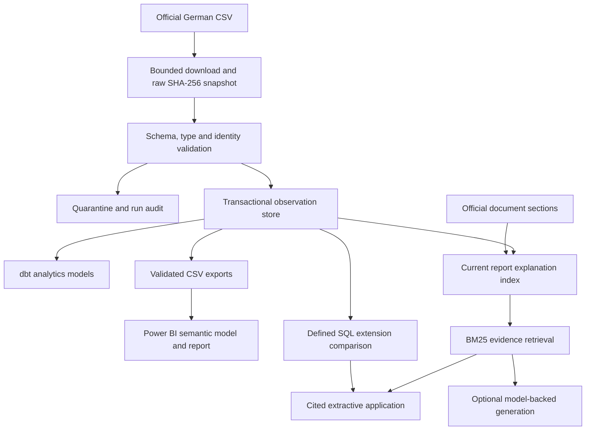

# Architecture and decisions

## 1. Preserve observations, not an invented historical truth

The source is a mutable list. An immutable copy documents exactly what was observed at a timestamp. `snapshots` identifies each accepted publication; `observations` contains its accepted package records. We do not reconstruct daily historical states from source update dates.

The raw file uses a content hash, while the snapshot ID combines normalized UTC timestamp and hash. Identical bytes at a new timestamp represent another observation. Identical bytes at the same timestamp are a safe replay.

Imports must be chronological. Backfills into an existing observation database are refused rather than silently corrupting adjacent change comparisons. Import historical observations into a clean store in chronological order.

## 2. Keep invalid rows visible

Required source columns, column counts, dates, identifiers, classifications and product-identity conflicts are checked before publication. More than 5% invalid rows blocks a snapshot. Failed runs do not advance the accepted snapshot. Raw bytes remain available even for schema-level failures.

SQLite `BEGIN IMMEDIATE` serializes ingestion writers. The PostgreSQL path uses a transaction advisory lock. Publication, observations, changes and successful audit counts commit together. A failed attempt rolls back and records its error separately. The local raw-byte write precedes the transaction so failed input remains inspectable.

## 3. Track source fields and membership without claiming resolution

`changes` distinguishes `first_observed`, `field_changed`, and `not_in_latest_feed`. The first accepted snapshot has no change events. A later expected end date is measured by comparing ISO dates for the same accepted product key across consecutive snapshots.

A record excluded by validation may appear missing from the accepted snapshot; analysts must inspect the quality audit before treating a membership change as meaningful. Nothing labels disappearance as clinical resolution.

## 4. Start with a local database

SQLite is the executed baseline because it needs no server. The PostgreSQL adapter shares the operational schema and query contract, with PostgreSQL-specific placeholder and view DDL handling. PostgreSQL integration is supplied as an opt-in test and CI service, but was not executed in this environment. Docker Compose supports the intended deployment path.

dbt provides independently inspectable product/snapshot dimensions, observation/change facts, current-state and quality marts. The portable SELECTs were executed against SQLite, and `dbt parse` ran successfully. This is separate from a PostgreSQL `dbt build` acceptance check.

## 5. Use retrieval for evidence and SQL for arithmetic

The evidence index contains only explanations from the latest accepted snapshot plus versioned official document sections. It rejects a stale index whose snapshot ID differs from the store. BM25 provides an inexpensive lexical baseline. Exact product names work well; multilingual paraphrases, typos and chemical synonym resolution are limited.

The default UI returns labelled extractive passages. Optional generation calls OpenAI's documented chat-completions interface with evidence as untrusted content and validates citation IDs. It has not been live-tested; citation IDs do not establish groundedness. Clinical questions and unspecified aggregate questions use explicit scope responses. The small gates are not comprehensive security or medical-safety controls.

The defined expected-end extension intent uses parameter-free, fixed SQL and attaches the source reasons for matching records. Arbitrary generated SQL is never executed.

## 6. Make Power BI inspectable

The native PBIP uses PBIR report definitions and a TMSL `model.bim` semantic model. Five tables and four single-direction relationships connect the snapshot and product dimensions to observation/change facts. The run audit is disconnected. Exported IDs remain text; explicit M conversions handle dates and numeric flags.

Observation measures evaluate the latest timestamp in the selected snapshot context, avoiding double-counting products across all historical snapshots. Quality totals summarize exported attempts. The report includes an explicit baseline note. Its schemas and model references were checked, but M, DAX and visual rendering need Desktop acceptance.

## 7. Avoid infrastructure without a demonstrated need

This feed has hundreds of rows, not a distributed processing workload. Kafka, Spark, a managed warehouse and multi-agent orchestration would add operation costs without improving the first version's decisions. Semantic embeddings and a vector store are potential extensions after measuring lexical retrieval failures.

The packaged project is local research software. Authentication, shared multi-tenant access, service-level objectives, durable remote storage and production hosting are not provided.
